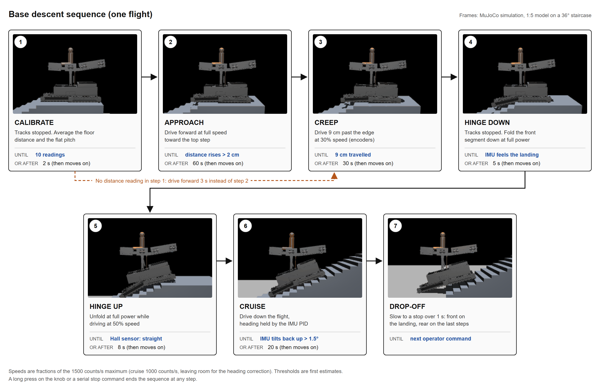
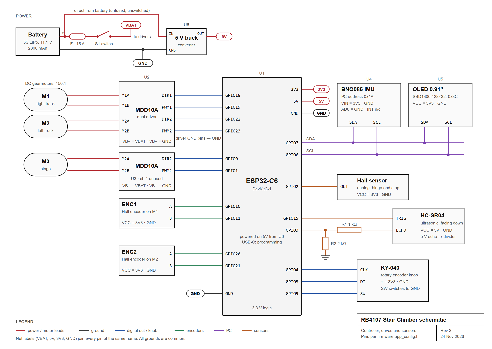
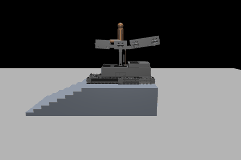
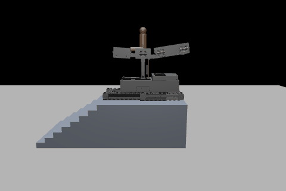
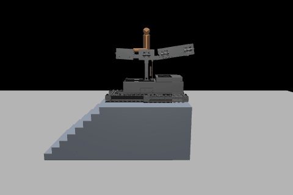
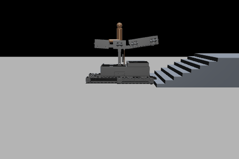
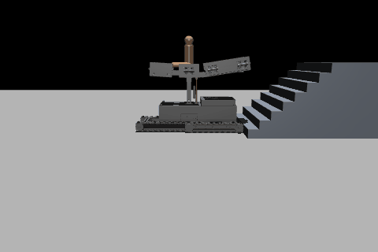
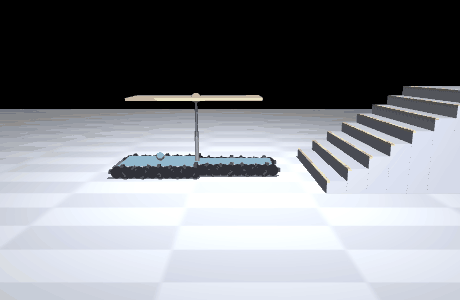

# RB4107 Stair-Climbing Evacuation Robot: Base Firmware

Firmware for the tracked base of a 1:5-scale robot that carries a casualty down aircraft
emergency airstairs (NUS RB4107 Robotics System Design Project). The base has a hinged,
two-segment track: it folds its front segment down over the top step, straightens on the
flight, drives straight down using an IMU heading controller, and stops at the bottom with
its rear still on the last steps, where the casualty is handed over.

| | |
|---|---|
|  |  |
| Descent sequence (frames from the MuJoCo simulation) | Base wiring |

## Repository layout

```
TwoMotorSync/         Main firmware (ESP32-C6). Open TwoMotorSync.ino in the Arduino IDE.
  docs/               Schematic, descent flowchart, drive-failure figure (PNG + SVG)
EncoderMotorSweep/    Early bench test for one motor + encoder + potentiometer (Arduino Uno)
cad/                  CAD model and fabrication pack, Rev C2 (STEP, drawings, DXF, STL, BOM)
simulation/           MuJoCo model of the robot and a Python port of the descent sequence
```

See [`cad/README.md`](cad/README.md) and [`simulation/README.md`](simulation/README.md).

## Simulation

MuJoCo runs of the robot model built from the CAD (details in [`simulation/`](simulation/README.md)).

<table>
<tr>
<td></td>
<td></td>
<td></td>
</tr>
<tr><td colspan="3" align="center">Descent, front first, at three stair angles</td></tr>
<tr>
<td></td>
<td></td>
<td></td>
</tr>
<tr><td colspan="2" align="center">Climbing in reverse (the steepest case stalls at the first riser)</td><td align="center">Early simplified model climbing over the top</td></tr>
</table>

## Hardware

| Part | Used for |
|---|---|
| ESP32-C6-DevKitC-1 | Controller (3.3 V logic, not 5 V tolerant) |
| 2 × Pololu 37D 12 V 150:1 gearmotor with 64 CPR encoder | Left and right tracks (9,600 counts per output turn) |
| 12 V worm gearmotor (5840-31ZY) | Hinge (self-locking) |
| 2 × Cytron MDD10A dual motor driver | #1: both tracks, #2 channel 2: hinge (channel 1 free for the levelling actuator) |
| BNO085 IMU (I²C, 0x4A) | Pitch, heading (yaw) and linear acceleration of the base |
| Analog Hall sensor + magnet | Hinge "straight" end stop |
| HC-SR04 ultrasonic, facing down | Stair edge detection (5 V echo through a 1 kΩ / 2 kΩ divider) |
| KY-040 rotary knob + 0.91" SSD1306 OLED (I²C, 0x3C) | On-robot control panel |
| 3S 2800 mAh LiPo, 15 A fuse, switch, 5 V buck converter | Power |

### Pin map (ESP32-C6)

| Signal | Pin | Connects to |
|---|---|---|
| Right track PWM / DIR | GPIO19 / GPIO18 | MDD10A #1 PWM1 / DIR1 |
| Left track PWM / DIR | GPIO23 / GPIO22 | MDD10A #1 PWM2 / DIR2 |
| Hinge PWM / DIR | GPIO1 / GPIO0 | MDD10A #2 PWM2 / DIR2 |
| Right encoder A / B | GPIO10 / GPIO11 | |
| Left encoder A / B | GPIO20 / GPIO21 | |
| I²C SDA / SCL | GPIO7 / GPIO6 | IMU and OLED (shared bus) |
| Hall sensor | GPIO2 (ADC) | |
| Ultrasonic TRIG / ECHO | GPIO15 / GPIO3 | ECHO through the divider |
| Knob CLK / DT / SW | GPIO4 / GPIO5 / GPIO9 | SW is also the BOOT button |

All pins and tuning values live in [`TwoMotorSync/app_config.h`](TwoMotorSync/app_config.h).
An Arduino Uno pin set is also kept there for bench testing without the panel.

## Building and flashing

No external libraries are needed (the IMU, OLED and encoder drivers are written in-house).

**Arduino IDE:** install the *esp32 by Espressif Systems* board package (3.x), select
**ESP32C6 Dev Module**, open `TwoMotorSync/TwoMotorSync.ino` and upload.

**arduino-cli:**

```sh
arduino-cli core install esp32:esp32
arduino-cli compile -b esp32:esp32:esp32c6 -u -p <PORT> TwoMotorSync
```

## Using it

**Control panel (knob + OLED).** The top two rows show pitch, hinge PWM, the Hall reading and
the distance sensor. Turn to move the highlight, click to select, long-press to stop everything.

- `DESCEND`: run the descent sequence (shows the current step while it runs).
- `DEBUG`: drive forward / backward at full speed, hinge up (stops at the Hall end stop) and
  hinge down. Click an item again to stop it.

**Serial (115200 baud).** Commands end with a newline:

| Command | Action |
|---|---|
| `F` / `R` / `S` | Tracks forward / reverse at the default speed / stop everything |
| `<number>` | Track speed in encoder counts/s (clamped to ±1500) |
| `HF` / `HR` / `HS` | Hinge up / down at the default PWM / stop |
| `H<number>` | Hinge PWM (−255 to 255) |
| `D` | Run the descent sequence |

Telemetry is printed as CSV every 200 ms:
`hall_raw,hall,stop,pitch,acc_up,acc_fwd,yaw,turn,mode,target,v1,v2,pwm1,pwm2,hinge,dist_cm`.

## Firmware structure

The code is split into three layers so each file has one job:

| Layer | Files | Role |
|---|---|---|
| Driver | `drv_*` | Talk to one piece of hardware (motor, encoder, Hall, BNO08x, OLED, ultrasonic, button, I²C) |
| Middleware | `mid_*` | Per-motor PI speed loop, IMU pitch / heading / acceleration, hinge with Hall end stop, knob, serial parsing |
| Application | `app_*`, `TwoMotorSync.ino` | Descent state machine, control panel, configuration and the 10 ms control loop |

The heading controller is a PID on the IMU yaw that adds a correction to one track's speed and
subtracts it from the other, on top of each motor's own PI speed loop.

### Descent sequence (`app_descend`)

1. **Calibrate:** tracks stopped; average the floor distance and the flat pitch.
2. **Approach:** drive forward until the distance rises by more than 2 cm (stair edge).
   If the distance sensor gives no reading, drive forward for 3 s instead.
3. **Creep:** drive 9 cm further at 30 % speed, measured by the encoders.
4. **Hinge down:** stop and fold the front segment down until the IMU feels the base being pushed
   up or forward (front segment landed).
5. **Hinge up:** unfold while driving at 50 % speed until the Hall sensor says straight.
6. **Cruise:** drive down the flight with heading hold until the pitch rises 1.5° back from its
   steepest value (front on the landing), then slow to a stop over 1 s.
7. **Done:** stopped at the drop-off point.

Every step has a time limit; a step that reaches it moves on to the next, so the robot never
stalls halfway down a step. All thresholds are in `app_config.h` and are first estimates.

## Known limitations

- The acrylic and PETG frame flexes under load, so the left drive belt (longer stage-1 belt,
  longer hinge shaft) slips when lifting the robot onto the first step from the floor.
  Descent and climbing from on the stairs work. See `docs/left_drive_failure.png`.
- The HC-SR04 returned no echo on the final wiring; the sequence falls back to a timed approach.
- The 5 V buck converter is wired directly to the battery, ahead of the fuse and switch.
- Thresholds and the heading PID gains have not been fully tuned on the stairs.

## Team and licence

RB4107 Robotics System Design Project, National University of Singapore.
Released under the [MIT License](LICENSE).
