# MuJoCo simulation

MuJoCo model of the full robot (base, hinged tracks, levelling actuator and seat) built from the
Fusion 360 CAD, plus a Python port of the base's descent state machine. It runs the robot on
eight-step 1:5 staircases at 24°, 32° and 40°, going down front first and climbing in reverse.


## Gallery

**CAD-based model**, 60 s runs (`media/sim_*.gif`):

<table>
<tr>
<td>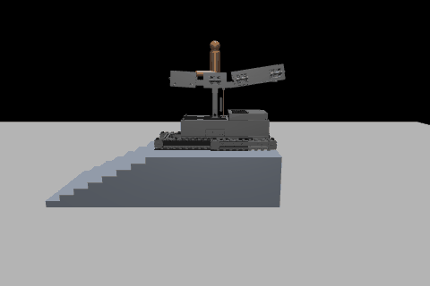</td>
<td>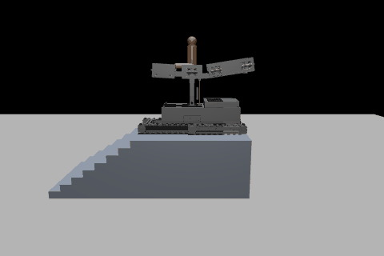</td>
<td>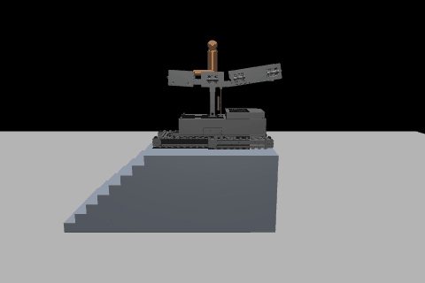</td>
</tr>
<tr><td colspan="3" align="center">Descent at three stair angles</td></tr>
<tr>
<td>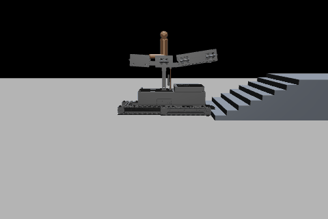</td>
<td>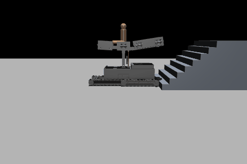</td>
<td></td>
</tr>
<tr><td colspan="2" align="center">Climbing in reverse; the steepest case stalls at the first riser</td><td></td></tr>
</table>

**Early simplified model** (box base with stretcher, before the CAD import) climbing up and over the
top at five stair angles (`media/climb_*.gif`):

<table>
<tr>
<td>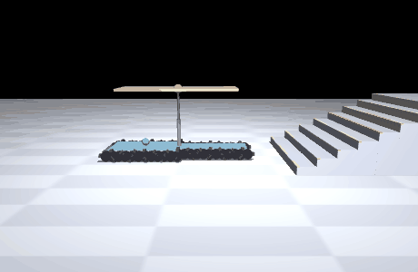</td>
<td>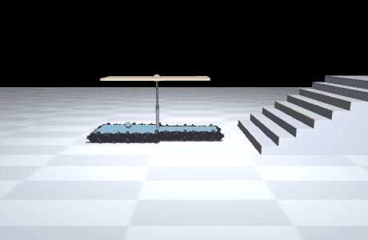</td>
<td>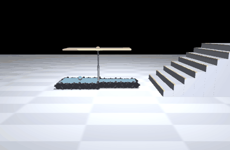</td>
</tr>
<tr>
<td>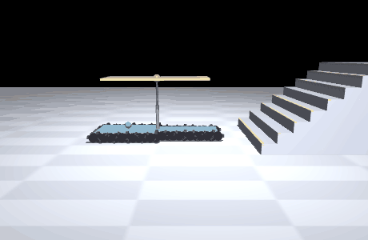</td>
<td>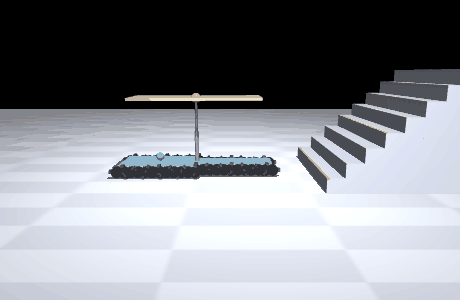</td>
<td></td>
</tr>
</table>

**Descent controller runs** from `owner_test.py` (one frame every 10 s, `media/owner_*.gif`):
down at 24°, 32° and 40°, up at 24° and 40°.

<table>
<tr>
<td>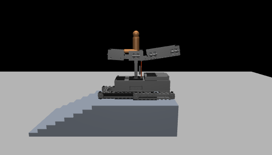</td>
<td>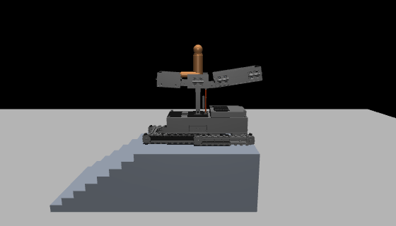</td>
<td>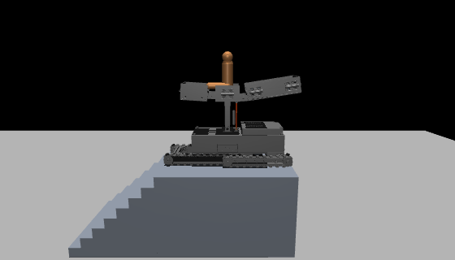</td>
<td>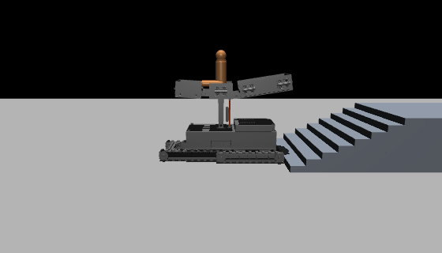</td>
<td>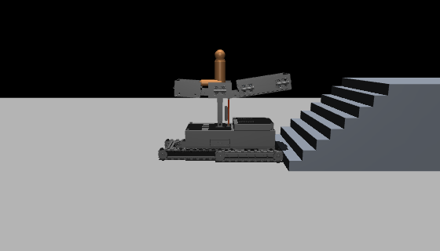</td>
</tr>
</table>

## Files

| Path | What it is |
|---|---|
| `model/StairClimber.xml`, `model/meshes/` | The robot exported from the CAD (85 STL meshes) |
| `owner_{down,up}_{angle}.xml` | Robot on a staircase: `down_24`, `down_32`, `down_40`, `up_24`, `up_40` |
| `owner_controller.py` | Python port of the firmware's descent sequence (`reset()` / `control()`) |
| `owner_test.py` | Runs all five scenarios for 60 s, prints a JSON summary and saves a GIF of each |
| `owner_extended.py` | Runs the three descents until the robot reaches the bottom, writes `owner_extended_results.json` |
| `DESCENT_REPORT.md`, `SCORING_ERRATUM.md` | Results and caveats from the last run |
| `reference-firmware/` | The firmware files the controller was ported from |
| `media/` | GIFs from the runs (`sim_0.gif` / `climb_0.gif` are the frames used in the report) |

## Running

Needs Python 3.10+ and the packages in `requirements.txt` (tested with MuJoCo 4.0.1).

```sh
cd simulation
pip install -r requirements.txt

# Look at a scene in the interactive viewer (no controller, the robot just sits there)
python -m mujoco.viewer --mjcf=owner_down_40.xml

# Run the descent controller on all five scenarios (writes owner_*.gif here)
python owner_test.py

# Run the three descents until they reach the bottom
python owner_extended.py
```

## Caveats

This is an exploratory model, not a safety case. See `DESCENT_REPORT.md` for the full list; the main points:

- The controller ports an **earlier** version of the descent firmware, which stops when the base is
  flat again. The current firmware in `TwoMotorSync/` stops when the pitch starts tilting back up
  at the bottom of the flight, so the stop behaviour differs.
- Belts are approximated by rollers and cleat contacts; the visual meshes do not collide.
- Motor, hinge and actuator parameters are estimates. Contact and timestep convergence were not
  established, so exact times and positions are provisional.
- The CAD mass (about 7.4 kg) has not been checked against the real robot.
